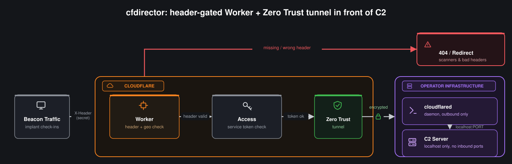

<p align="center">
  
</p>

# cfdirector

Reading and implementing [Securing C2 for RT Operations using Cloudflare](https://cgomezsec.com/blog/securing-c2-for-rt-operations-using-cloudflare) on my engagements is what inspired this tool. Shoutout to [Hexix23](https://github.com/Hexix23) for the writeup.

cfdirector stands up a header-gated redirector in front of your C2 on Cloudflare. A public domain fronts a Worker that only passes traffic carrying the secret header baked into your profile, everything else gets a 404 or a redirect to somewhere else. Traffic that checks out rides an Access-protected Zero Trust tunnel back to the teamserver on operator infrastructure, so the box running it never has an inbound port open to the internet.

<p align="center">
  
</p>

It also does internal-only services: no Worker, no public domain, just a tunnel hostname behind your own Cloudflare Access login, good for team infra you want reachable only by whoever's logged in on the engagement.

## Setup

```bash
git clone https://github.com/adot8/cfdirector.git && cd cfdirector
cp .env.example .env && chmod 600 .env
```

Fill in `CF_API_TOKEN` and `CF_ACCOUNT_ID` in `.env`. The token needs Account Tunnel Edit, Access Apps and Policies Edit, Access Service Tokens Edit, Zone DNS Edit and Zone Read. `OWNER_EMAIL` is only needed for `--internal` services, it's the operator email let through Access.

You also need `python3`, [cloudflared](https://github.com/cloudflare/cloudflared) and [wrangler](https://developers.cloudflare.com/workers/wrangler/) on your PATH. Worker deploys go through `wrangler login`, it prompts you the first time.

## Usage

```bash
usage: cfdirector.py [-h] {up,down} ...

positional arguments:
  {up,down}

options:
  -h, --help  show this help message and exit

usage: cfdirector.py up [-h] -H HEADER [-o ORIGIN]
                        [--service DOMAIN,TUNNEL_HOST,ORIGIN]
                        [--internal TUNNEL_HOST,ORIGIN]
                        [--countries COUNTRIES] [--redirect REDIRECT]
                        [--teardown]
                        [domain] [tunnel_host]

positional arguments:
  domain                public Worker custom domain (omit to pick from your zones)
  tunnel_host           hostname routed to the tunnel, Access-protected (omit to pick from your zones)

options:
  -h, --help            show this help message and exit
  -H, --header HEADER   NAME or NAME:VALUE the client must send (random value if omitted)
  -o, --origin ORIGIN   local service behind the tunnel (default http://localhost:80)
  --service DOMAIN,TUNNEL_HOST,ORIGIN
                        add another external service sharing this one tunnel; repeatable
  --internal TUNNEL_HOST,ORIGIN
                        add an internal-only service (no public domain/Worker,
                        Access-login gated); repeatable
  --countries COUNTRIES
                        comma-separated ISO country codes to allow (e.g. US,CA); unset = no geo restriction
  --redirect REDIRECT   URL to redirect to when blocked; unset = 404
  --teardown            tear down on exit without asking (for services/no tty)

usage: cfdirector.py down [-h] tunnel_host_group

positional arguments:
  tunnel_host_group  the first service's tunnel_host from the `up` that created this stack

ex: cfdirector.py up cdn.example.com tun.example.com -H X-TEST-HEADER:TEST123 -o https://localhost:8443
    cfdirector.py up -H X-TEST-HEADER:TEST123
    cfdirector.py down tun.example.com
```

Leave the hostnames off and it'll let you pick from your zones. `up` is idempotent, rerun it mid-engagement and it builds whatever's missing and reuses the rest. What exists is tracked in `state/<first-tunnel_host>.json`.

Multiple services can share one tunnel, good for running a teamserver and a payload-hosting listener off the same tunnel. The positional domain, tunnel host and `-o` are the first service, `--service` adds another public header-gated one and `--internal` adds an Access-login-only one:

```bash
./cfdirector.py up cdn1.example.com tun1.example.com -H X:v -o http://localhost:443 \
    --service cdn2.example.com,tun2.example.com,http://localhost:8087 \
    --internal admin.internal.example.com,http://localhost:9000
```

`down` takes the first service's tunnel host and tears the whole stack down.

## Operator prompt

Once the tunnel is up you land at a `cfdirector>` prompt. Everything here is live, cloudflared picks up the new ingress with no restart, swap the header mid-engagement if you think it's burned, add a service on the fly, nothing goes down.

```
list                                             show services with a test command each
add internal <tunnel_host> <origin>              Access-login-only service
add external <domain> <tunnel_host> <origin>     header-gated public service
remove <domain-or-tunnel_host>                   tear down one service, tunnel stays up
header <name> <value>                            change the gate header on every Worker
redirect <url|clear>                             set or clear the block-page redirect
countries <CSV|clear>                            set or clear the country allowlist
kill                                             stop the tunnel, then the teardown prompt
help                                             command list
```

## Notes

`state/` holds the service token secret and `.env` holds your API token. Both are gitignored, keep them that way, and off anything shared across the team outside what the engagement calls for.

Only point this at infrastructure you own or have signed authorization to operate. This is redirector infra, not a bypass for scope you don't have.

## Disclaimer

The information and materials provided in this repository are for **educational, research, and authorized testing purposes only**.

The author is **not responsible for any misuse, damage, or illegal actions** caused by the software, code, or information contained herein. By downloading, cloning, or using any part of this repository, you agree that you are solely responsible for your own actions and compliance with all applicable local, national, and international laws.

**Usage of these tools for attacking targets without prior mutual consent is illegal.** It is the end user's responsibility to obey all applicable laws. The author assumes no liability and is not responsible for any misuse or damage caused by this program.
